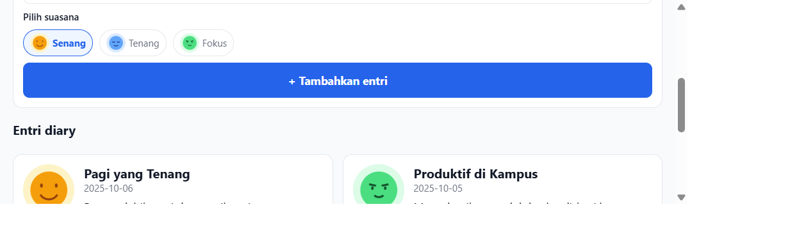
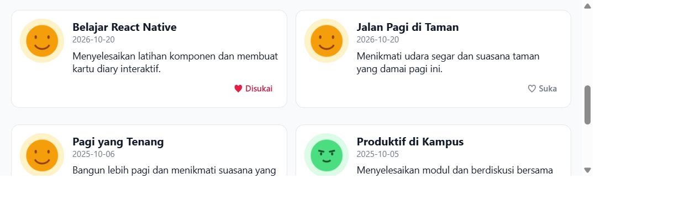

# Diary App

Nama: [Gieo sakti senja gumilang]
NIM: [2430511003]

## Fitur yang selesai
<<<<<<< HEAD
- Daftar entri diary dengan pencarian judul, cerita, dan tanggal.
- `DiaryCard` sebagai presentational component dengan data dan callback dari props.
- `SearchBar` dengan local state dan callback `onChange` ke screen.
- `EntryForm` sebagai controlled form untuk menambahkan entri ke state daftar.
- State `entries`, `query`, `likedIds`, dan `selected` dikelola di `DiaryListScreen`.
- Status suka dapat diubah langsung dari kartu tanpa memuat ulang aplikasi.
- Ilustrasi suasana hati lokal tersedia di `assets/moods`.
- Modal detail untuk membaca isi entri.
=======
Fitur & Poin Utama yang Diselesaikan

- Design Tokens & StyleSheet Terpusat: Penggunaan token konsisten untuk warna (COLORS), jarak (SPACE), sudut lengkung (RADIUS), tipografi (TYPO), dan breakpoint - layar (BREAKPOINTS) di src/styles/tokens.js.
- Reusable Component (DiaryCard): Kartu entri dinamis dengan interaksi sentuh (Pressable), efek ripple/opacity, dan label aksesibilitas (accessibilityLabel).
- Responsive Layout (1 & 2 Kolom): Memanfaatkan hook useWindowDimensions() untuk mendeteksi lebar layar, secara otomatis beralih dari tampilan 1 kolom (ponsel) ke 2 kolom (tablet atau layar dengan width >= 600px).
- Efficient List Rendering (FlatList): Menampilkan daftar entri secara efisien dengan penyesuaian jumlah kolom dan dukungan stable key re-rendering.
- Interactive Detail Modal (DiaryDetailModal): Menampilkan rincian lengkap entri diary termasuk hero image proporsional (aspectRatio: 16/9) dan tombol tutup tanpa berpindah screen.
- Aksesibilitas Dasar: Memastikan target sentuh yang layak, kontras teks yang konsisten, dan penggunaan SafeAreaView dari react-native-safe-area-context.
>>>>>>> 2a2da07e89805c205d2257eac9da08f329861453

## Cara menjalankan
1. Masuk ke folder proyek:
   ```bash
   cd diary-app
   ```
2. Jalankan server Expo:
   ```bash
   npx expo start
   ```
3. Buka aplikasi melalui Expo Go atau emulator Android.

## Pengujian manual
1. Jalankan aplikasi dan pastikan tiga entri awal tampil.
2. Isi judul dan cerita pada form, pilih suasana hati, lalu tekan **Tambahkan entri**.
3. Ulangi langkah tersebut untuk menambahkan minimal dua entri baru dan pastikan keduanya muncul paling atas.
4. Tekan **Suka** pada sebuah kartu dan pastikan status berubah menjadi **Disukai** tanpa memuat ulang aplikasi.
5. Cari salah satu entri dan buka kartu untuk memastikan pencarian serta modal detail berfungsi.

## Screenshot pengujian
Sebelum penambahan entri:



Sesudah menambahkan dua entri dan menyukai satu entri:


